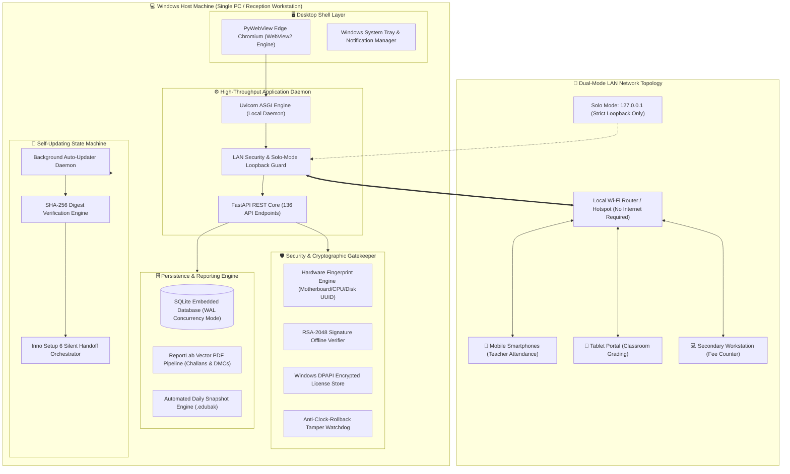

<div align="center">

# 🏫 EduSaaS Offline — Windows Desktop ERP
### Standalone Offline-First School Management & Institutional Accounting Workstation

[-0078D6?style=for-the-badge&logo=windows&logoColor=white)](#)
[](#)
[](#)
[](https://github.com/AbdulMoizAns/EduSaaS-Downloads/releases/latest/download/EduSaaS-Setup.exe)
[](https://edusaas.site)

<br/>

> 🔒 **Proprietary & Confidential Notice:**  
> *The source code, binary compilation pipeline, cryptographic algorithms, and underlying commercial logic of EduSaaS Offline are proprietary commercial property protected under non-disclosure and commercial licensing. This repository is a technical case study, architectural portfolio showcase, and systems engineering capability brief.*

---

</div>

## 📌 Executive Summary

**EduSaaS Offline** is a production-grade, standalone Windows desktop ERP engineered specifically for private schools, academies, tuition centers, and colleges operating in environments with intermittent, unreliable, or zero internet connectivity.

Unlike conventional cloud-only SaaS platforms that fail when connectivity drops or legacy desktop systems that require complex local servers (such as manually installed Node.js runtimes, PostgreSQL services, or IIS web servers), EduSaaS Offline operates as an **autonomous, zero-external-dependency workstation**:
- Runs **100% offline** on a standard Windows 10/11 laptop or desktop.
- Retains all institutional records locally in high-concurrency **SQLite with Write-Ahead Logging (WAL)**.
- Features a **Dual-Mode LAN Mesh** enabling faculty and accountants to connect smartphones, tablets, and other PCs over the school's local Wi-Fi router without internet access.
- Protected by a **Hardware-Anchored Cryptographic Licensing Engine (RSA-2048 & DPAPI)**, anti-clock-rollback watchdogs, and **Nuitka Native C compilation** that prevents source code extraction.

---

## 🏗️ High-Level System Architecture



---

## 🌟 Key Engineering & Architectural Innovations

### 1. ⚡ Autonomous Zero-Dependency Runtime
- **No External Prerequisites:** Installs in under 30 seconds via Inno Setup into `%LOCALAPPDATA%\Programs\EduSaaS` without requiring administrator privileges.
- **Embedded Web Engine:** Leverages the native Microsoft Edge WebView2 runtime pre-installed on modern Windows OS, eliminating 200MB+ Chromium binaries typical of Electron applications.
- **Low Resource Footprint:** Operates smoothly with only 90MB–120MB of RAM, making it performant on low-cost school counter laptops (Intel Core i3, 4GB RAM).

### 2. 📡 Dual-Mode LAN Mesh (Solo vs. Multi-Device)
Schools frequently operate multiple counters (reception, fee clerk, principal office) or require teachers to take classroom attendance on mobile devices without deploying expensive cloud servers:
- **Solo Mode (Default):** Restricts all traffic strictly to `127.0.0.1`. Requests originating outside the loopback interface are dropped at the ASGI middleware level, independent of Windows Firewall configurations.
- **LAN Sharing Mode:** With one click, the host PC binds to `0.0.0.0:8000`. The system broadcasts a local QR code and LAN URL (e.g. `http://192.168.1.5:8000`).
- **Zero-Cloud Collaboration:** Teachers, staff, and accountants connect over the school's local offline Wi-Fi access point simultaneously, writing to the same SQLite WAL database with zero internet bandwidth consumption.

### 3. 🔐 Multi-Tier Anti-Piracy & Cryptographic Security
Desktop applications distributed to end-user hardware require robust IP defense against piracy, license cloning, and cracking:
- **Nuitka Native C Compilation:** The entire application logic is compiled from Python directly into native C/C++ machine code using MinGW-w64. The executable contains **zero Python bytecode (`.pyc`)**, rendering standard decompilers (`pyinstxtractor`, `uncompyle6`) completely ineffective.
- **Asymmetric Offline Verification:** Paid licenses are signed with an RSA-2048 private key on the master license server. The desktop app verifies this signature offline using an embedded cryptographic public key. No online phone-home is required for continuous operation.
- **Machine-Bound DPAPI Storage:** License payloads are encrypted using the Windows **Data Protection API (DPAPI)** keyed to the user profile and machine GUID. A license file copied to another computer cannot be decrypted.
- **Anti-Clock-Rollback Protection:** High-resolution filesystem time anchors detect any attempts to extend evaluation trials by rolling back the Windows system clock.
- **Anchored 3-Day Evaluation:** Trial markers are stored across redundant, obfuscated Windows Registry hives and DPAPI files. Deleting configuration folders does not reset the trial period.

### 4. 📄 High-Performance Vector PDF Pipeline (ReportLab)
Traditional web apps generate PDFs by spawning headless Chromium instances (Puppeteer/Playwright), consuming 500MB+ memory and taking 3–6 seconds per document. EduSaaS Offline features a custom vector drawing engine built with **ReportLab**:
- **Sub-200ms Generation:** Generates bank challans, student ID cards, marksheets, and leaving certificates in under 180 milliseconds.
- **Pakistani Banking Standard 3-Copy Challans:** Formatted into **Bank Copy, School Copy, and Student Copy** on a single A4 sheet with tabular fee breakdowns, arrears, late fee penalties, and verification barcodes.
- **Bulk DMC Engine:** Generates entire school examination report cards (Detailed Marks Certificates) in a single consolidated PDF stream ready for batch printing.

### 5. 🔄 Autonomous Background Auto-Updater
Even offline-first software must maintain a modern release lifecycle:
- When an internet connection is detected, the background updater polls `edusaas.site/api/updates/desktop`.
- New versions are downloaded silently in chunks with comprehensive **SHA-256 digest validation**.
- When ready, a non-intrusive notification provides a 30-second silent installation countdown.
- Hands off execution to Inno Setup, terminates gracefully, updates the binary, and re-launches the application while preserving `%APPDATA%\EduSaaS\data\school.db`.

---

## 🏛️ Comprehensive Functional Modules

```
┌────────────────────────────────────────────────────────────────────────┐
│                     EduSaaS Offline Functional Matrix                  │
├──────────────────┬──────────────────┬─────────────────┬────────────────┤
│ 1. Student SIS   │ 2. Fee Counter   │ 3. Exams & DMC  │ 4. Certificates│
│ - GR No Register │ - 3-Copy Challan │ - Subject Marks │ - School Leave │
│ - Class/Section  │ - Instant Pay Slip - Position Ranks │ - Character    │
│ - ID Card Studio │ - Defaulter Ledger- Printable DMC  │ - Bonafide     │
├──────────────────┼──────────────────┼─────────────────┼────────────────┤
│ 5. Attendance    │ 6. Accounting    │ 7. Staff & HR   │ 8. Utilities   │
│ - 1-Click Hazri  │ - Cash Book & P&L│ - Teacher Attend│ - 1-Click USB  │
│ - Monthly Ledger │ - Expense Ledger │ - Salary Slips  │ - Auto-Backup  │
│ - Absence Alerts │ - Multi-Accounts │ - Payroll Print │ - WhatsApp Q   │
└──────────────────┴──────────────────┴─────────────────┴────────────────┘
```

### Module Breakdown:
1. **Student Information System (SIS):** General Register (GR No) indexing, parentage verification, B-Form tracking, student directory search, and bulk printable student ID cards.
2. **Fee Counter & Challan Engine:** Automated tuition fee generation, concession rules, monthly billing cycles, 3-copy bank vouchers, instant payment receipts, and real-time defaulter lists.
3. **Exams, DMC & Grading Engine:** Exam term configurations (Mid-Term, Final, Monthly), subject-wise grading, automated class ranking (1st, 2nd, 3rd positions), and single/bulk Detailed Marks Certificates (DMC).
4. **Certificate Studio:** One-click generation of School Leaving Certificates (SLC), Transfer Certificates (TC), Character Certificates, and Bonafide Certificates with customizable school crest and signatures.
5. **Class Attendance:** 60-second class attendance logging with duplicate-entry prevention, monthly registers, and daily absentee digests.
6. **Double-Entry Cash Book & Expenses:** Complete school ledger tracking tuition inflows, administrative expenditures, petty cash, and net profit/loss summaries.
7. **Staff Payroll & HR:** Teacher and staff profiles, daily staff attendance registers, and monthly salary slip generation.
8. **WhatsApp Offline Outbox:** Queues automated fee payment receipts, absentee alerts, and exam notices with click-to-send messaging (works without requiring active API keys).
9. **Automated Data Protection:** Automated daily backup engine creating timestamped `.edubak` archives with 30-day retention and 1-click USB flash drive export/restore.

---

## 🔐 4-Tier Role-Based Privilege Matrix

| Module / Action | `ADMIN` | `ACCOUNTANT` | `TEACHER` | `CLERK` |
| :--- | :---: | :---: | :---: | :---: |
| **School Settings & Profile** | ✅ Full Access | ❌ Blocked | ❌ Blocked | ❌ Blocked |
| **Student Admissions & GR Edit** | ✅ Full Access | ❌ Blocked | ❌ Read Only | ✅ Full Access |
| **Fee Challans & Collection** | ✅ Full Access | ✅ Full Access | ❌ Blocked | ❌ Blocked |
| **Accounting, Cash Book & P&L** | ✅ Full Access | ✅ Full Access | ❌ Blocked | ❌ Blocked |
| **Staff Payroll & Salaries** | ✅ Full Access | ✅ Full Access | ❌ Blocked | ❌ Blocked |
| **Daily Attendance Logging** | ✅ Full Access | ❌ Blocked | ✅ Full Access | ❌ Blocked |
| **Exam Marks Entry & DMCs** | ✅ Full Access | ❌ Blocked | ✅ Assigned Subjects | ❌ Blocked |
| **Certificates Generation** | ✅ Full Access | ❌ Blocked | ❌ Blocked | ✅ Full Access |
| **Database Backup & Restore** | ✅ Full Access | ❌ Blocked | ❌ Blocked | ❌ Blocked |

*Access control is strictly validated on every REST API request on the FastAPI backend, preventing unauthorized API replay over the local LAN.*

---

## 📊 Scale & Performance Metrics

```
🖥️ Target Operating System     : Windows 10 & Windows 11 (64-bit)
🚀 Cold Start Time             : < 1.2 Seconds to Interactive UI
🔌 API Surface Area            : 136 Validated REST Endpoints
🗄️ Relational Domain Entities   : 20 SQLAlchemy Models (SQLite WAL Mode)
⚡ Local API Latency           : Sub-15ms Average Response Time
📄 Vector PDF Generation       : < 180ms per 3-Copy Challan / DMC Card
💾 Application Memory Footprint : 90MB – 120MB (Low RAM Overhead)
📦 Distribution Binary Size    : Fully Self-Contained Native Windows Installer
🛡️ Anti-Piracy Architecture   : Nuitka Native C Binary + RSA-2048 + Windows DPAPI
```

---

## 🌐 Official Distribution & Inquiries

- **Official Website:** [edusaas.site](https://edusaas.site)
- **Direct Installer Download:** [EduSaaS-Setup.exe (v1.2.0 Stable)](https://github.com/AbdulMoizAns/EduSaaS-Downloads/releases/latest/download/EduSaaS-Setup.exe)
- **Architect & Lead Systems Engineer:** [Abdul Moiz Ansari](https://github.com/AbdulMoizAns)
- **LinkedIn:** [Abdul Moiz Ansari](https://www.linkedin.com/in/abdul-moiz-ansari-91a132234)

---

<div align="center">
  <sub>© 2024–2026 EduSaaS — Offline Desktop Edition. All rights reserved. Proprietary software — source code not distributed publicly.</sub>
</div>
